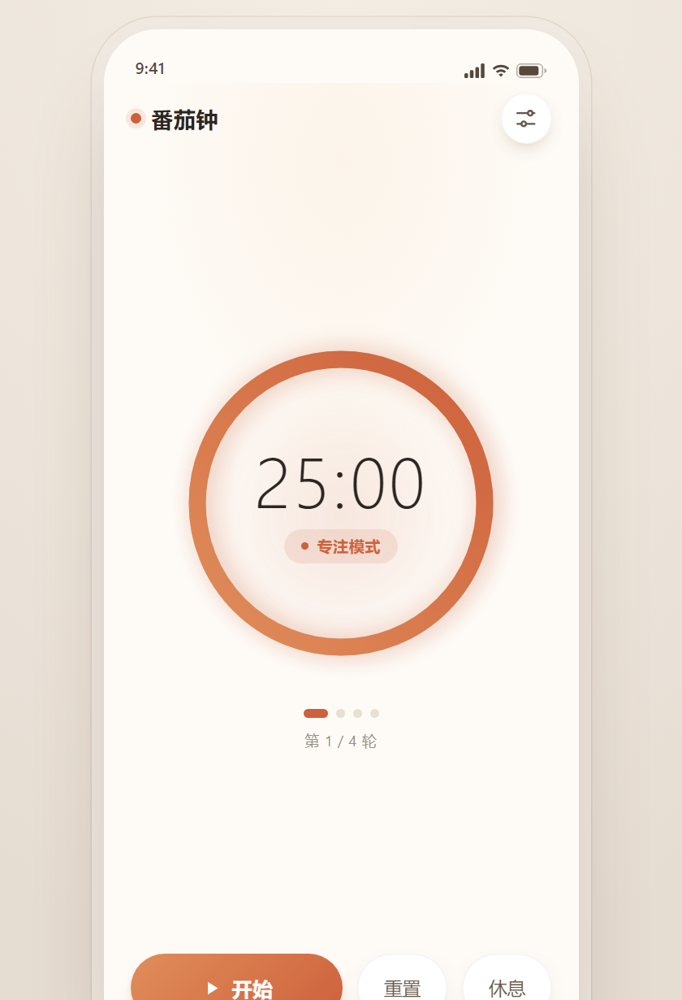
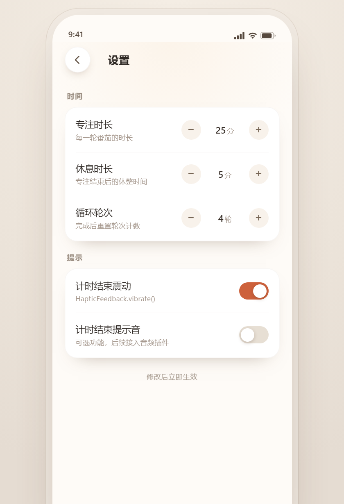

# 🍅 番茄钟 · Pomodoro Timer

一个用 Flutter 实现的移动端番茄钟应用，帮助你专注工作、高效休息。

界面采用暖色调设计，支持自定义专注/休息时长、循环轮次，计时结束震动提醒。动画效果全部基于 Flutter 第九章（动画）实现，包含交织动画、缩放淡入弹窗、模式切换动画、自定义路由过渡等。

---

## ✨ 功能介绍

### 核心计时
- ⏱️ **自定义时长**：专注时长、休息时长、循环轮次均可自由设置
- ▶️ **开始 / 暂停 / 重置**：完整的计时控制
- 🔄 **循环轮次**：支持多轮番茄，重置时轮次归零
- 🔀 **专注 / 休息模式一键切换**：底部按钮在「休息」「专注」间切换

### 设置项
- 🎯 专注时长设置
- ☕ 休息时长设置
- 🔁 循环轮次（番茄数）
- 📳 计时结束震动提醒
- 🔔 计时结束提示音（预留，后续接入音频插件）

### 动画效果（基于 Flutter 第九章）
- **交织动画（Stagger）**：点击开始时，外圈进度条放大 → 时间文字淡入 → 底部按钮上滑，依次错开执行
- **ScaleTransition + FadeTransition**：计时结束时，弹窗缩放 + 淡入弹出
- **AnimatedSwitcher**：切换「专注模式 / 休息模式」时，界面文字平滑切换
- **PageRouteBuilder**：打开设置页时，自定义路由过渡动画（首页缩小后退 + 设置页横向滑入）

---

## 📱 界面预览

| 首页（专注模式） | 设置页 |
|:---:|:---:|
|  |  |

---

## 📥 下载安装（仅 Android）

> ⚠️ 本应用仅提供 Android 版本，暂不支持 iOS。

### 方式一：扫码下载

用手机浏览器扫描下方二维码，直接下载 APK 安装包：


### 方式二：Releases 下载

前往 [Releases 页面](https://github.com/langjinbuhuitou/pomodoro-timer/releases) 下载最新版本的 `pomodoro-release.apk`，在手机上安装即可。

最新版本：**v1.0.0**

👉 [点击下载 pomodoro-release.apk](https://github.com/langjinbuhuitou/pomodoro-timer/releases/download/v1.0.0/pomodoro-release.apk)

### 安装说明
1. 下载 APK 后，在手机文件管理器中点击安装
2. 如提示「未知来源」，请在系统设置中允许安装
3. 安装完成后即可在桌面找到「番茄钟」图标启动

---

## 🛠️ 技术栈

- **框架**：Flutter
- **语言**：Dart
- **状态管理**：StatefulWidget + setState
- **动画**：AnimationController、Animation<double>、Interval（交织动画）、ScaleTransition、FadeTransition、AnimatedSwitcher、PageRouteBuilder
- **震动**：HapticFeedback
- **构建**：release APK（已签名）

## 📂 项目结构

```
pomodoro_app/
├── lib/
│   └── main.dart          # 应用主入口（单文件，含所有页面与动画）
├── android/               # Android 平台工程
├── assets_readme/         # README 预览图与下载二维码
├── pubspec.yaml
└── .gitignore
```

## 🚀 本地运行

```bash
flutter pub get
flutter run
```

## 📄 开源协议

MIT
